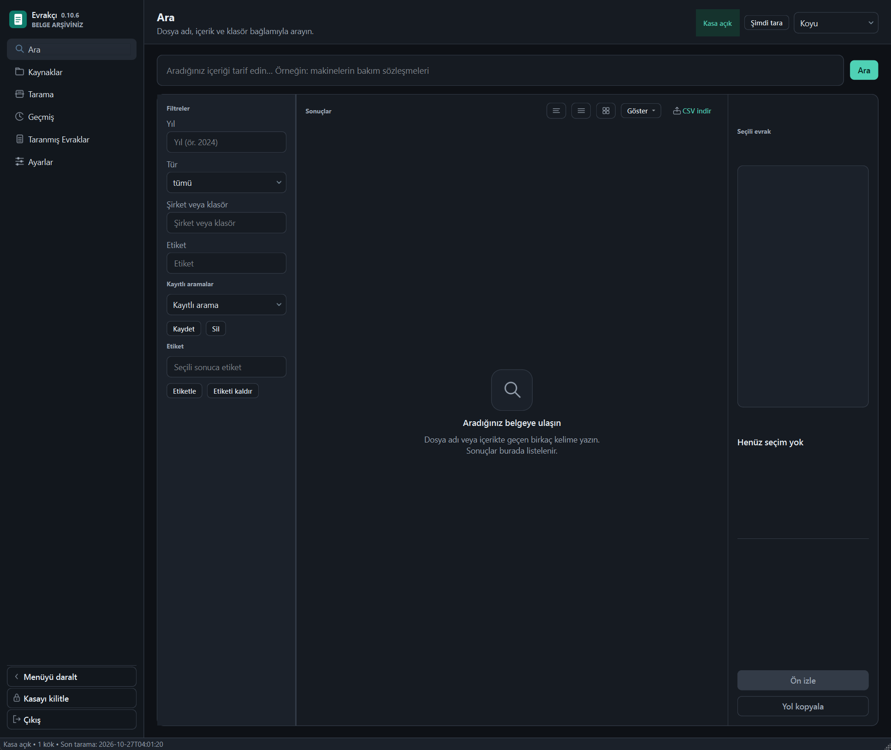
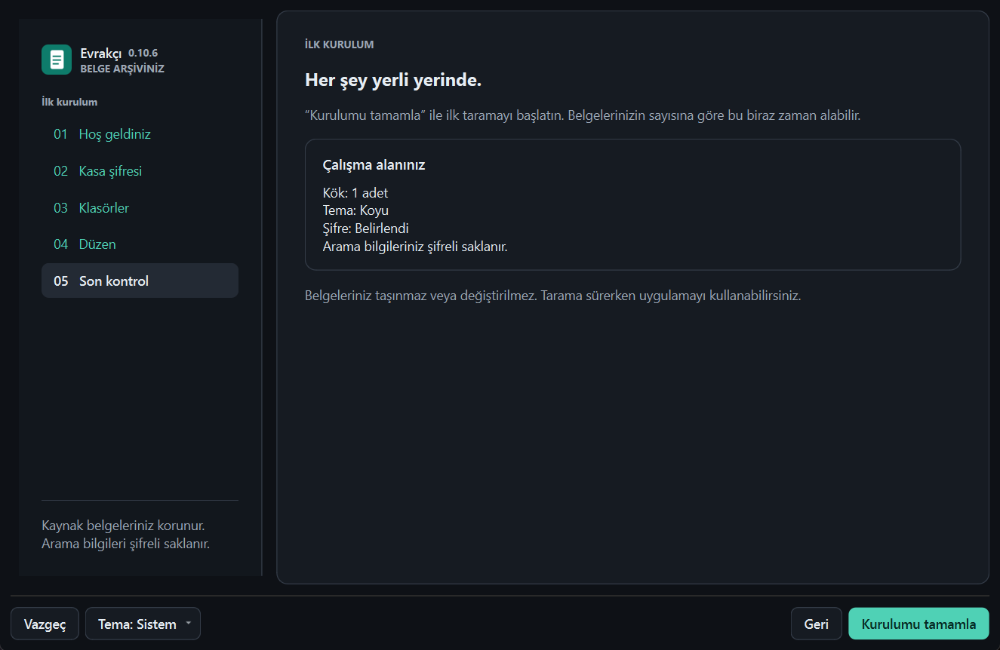
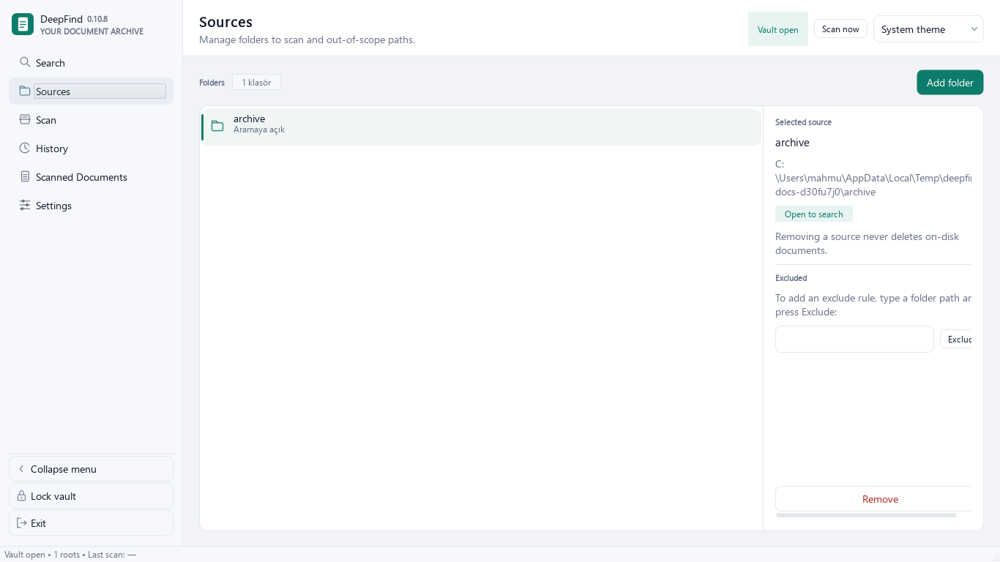
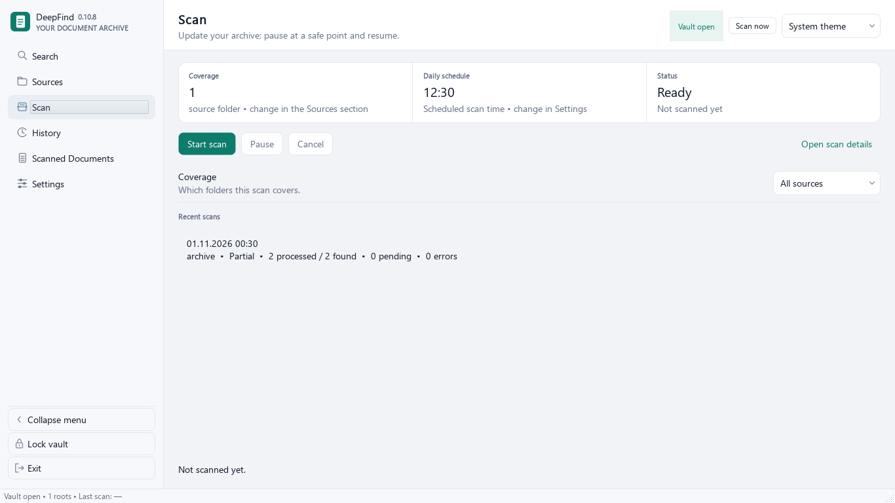
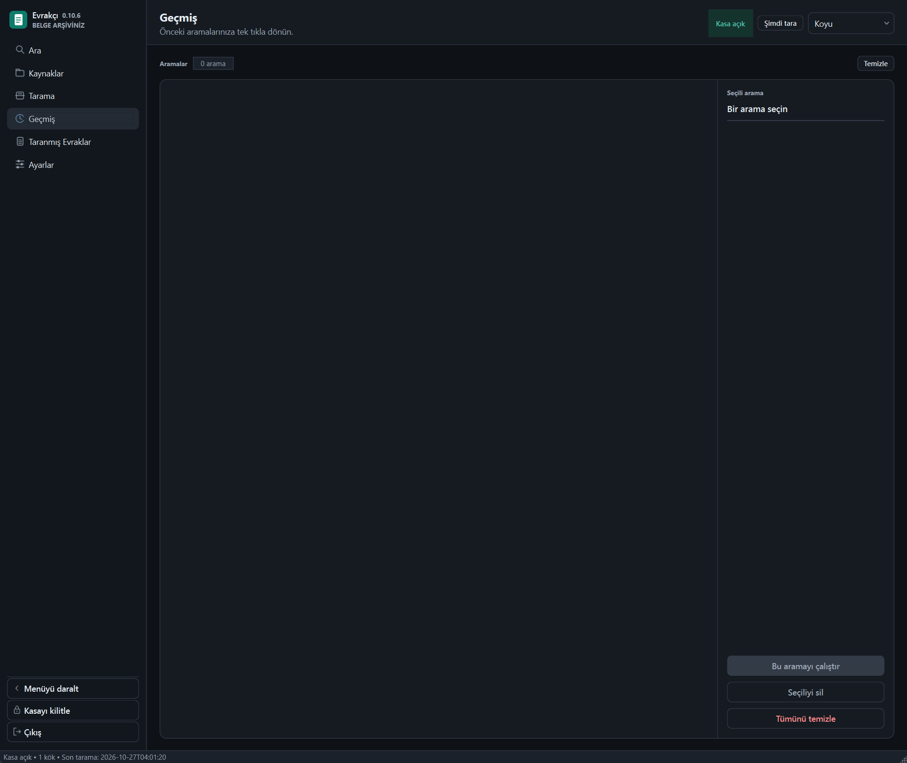
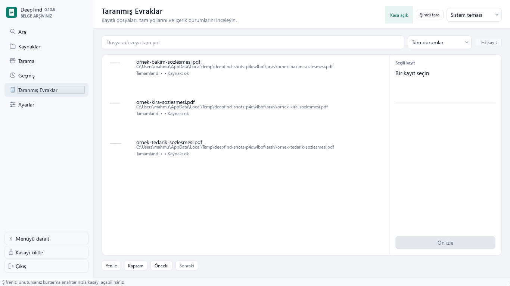
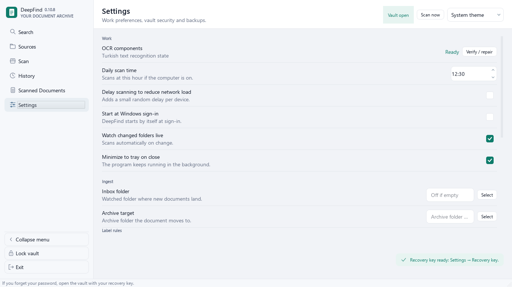

# DeepFind — Windows için yerel, şifreli belge arama

> English: [README.md](./README.md)

**Kaydettiğin dosya adını değil, hatırladığın belgeyi tarif et.**

DeepFind, klasörlerinde duran belgeleri indeksler — PDF, XLSX/XLS, DOCX, ODT, RTF, TXT/CSV ve taranmış JPG/PNG/TIFF — ve onları anlamına göre bulur. Dosyalar hiç taşınmaz. İndeks makinenin içinde SQLCipher ile şifreli bir kasada durur ve belgelerin hakkında hiçbir şey dışarı gönderilmez.



---

## İçindekiler

- [Ne yapar](#ne-yapar)
- [Ekranlar, tek tek](#ekranlar-tek-tek)
  - [1. İlk kurulum](#1-i̇lk-kurulum)
  - [2. Arama](#2-arama)
  - [3. Kaynaklar](#3-kaynaklar)
  - [4. Tarama](#4-tarama)
  - [5. Geçmiş](#5-geçmiş)
  - [6. Taranmış evraklar](#6-taranmış-evraklar)
  - [7. Ayarlar](#7-ayarlar)
- [Kurulum](#kurulum)
- [Anlamsal arama nasıl çalışır](#anlamsal-arama-nasıl-çalışır)
- [Kasa ve güvenlik](#kasa-ve-güvenlik)
- [OCR ve önizleme](#ocr-ve-önizleme)
- [Kaynaktan derleme](#kaynaktan-derleme)
- [Bilinmesi gereken sınırlar](#bilinmesi-gereken-sınırlar)
- [Lisans](#lisans)

---

## Ne yapar

| Yetenek | Ayrıntı |
|---|---|
| **Anlamsal arama** | EmbeddingGemma 2 Q8_0, 256 boyutlu L2 normalize vektörler — içeriği tarif ederek ara |
| **Geniş biçim desteği** | PDF, XLSX/XLS, DOCX, ODT, RTF, TXT/CSV, JPG/PNG/TIFF |
| **OCR** | taranmış PDF ve görseller için RapidOCR, gömülü PP-OCR modelleri ve ONNX Runtime |
| **Şifreli kasa** | SQLCipher veritabanı, parola ve kurtarma anahtarı |
| **Yerel modeller** | metin modeli, Vulkan/CPU motorları ve OCR kurulumla gelir — internet, API anahtarı, Ollama veya Python gerekmez |
| **İsteğe bağlı GPU** | CUDA bileşeni istek üzerine iner (~663 MB, sabit sürüm ve SHA-256); Vulkan ve CPU ana pakettedir |
| **Kaynak yönetimi** | klasör ekle, yolları hariç tut, değişiklikleri canlı izle |
| **Önizleme** | uygulama içinde PDF önizlemesi ve küçük resimler |
| **Filtreler** | anlamsal sıralamanın üstünde klasör, tür, yıl ve etiket |
| **Kendi kendine güncelleme** | günlük denetim, SHA-256 doğrulamalı, aynı kurulum yerinde yükseltilir |

---

## Ekranlar, tek tek

### 1. İlk kurulum



Beş adım ve son adım ne olacağını birebir gösterir.

1. **Hoş geldiniz** — uygulamanın ne yaptığı, tek ekranda.
2. **Kasa şifresi** — indeksi şifreleyen parolayı seç. Windows kullanıcısı için DPAPI ile hatırlanabilir.
3. **Klasörler** — indekslenecek klasörleri ağaçtan seç veya yolu yaz. Hiçbir şey taşınmaz veya değişmez; klasör olduğu yerde kalır.
4. **Düzen** — her kök için klasör bağlamının nasıl okunacağı, kaydedilmeden önce önizlenir.
5. **Son kontrol** — kök sayısı, tema ve şifre durumu özeti; ayrıca belgelerin taşınmadığı/değişmediği ve ilk tarama sürerken uygulamayı kullanabileceğin notu.

`Kurulumu tamamla` ilk taramayı başlatır. Büyük bir arşiv zaman alır; uygulama boyunca kullanılabilir kalır.

### 2. Arama


Tek kutu ve aradığının tarifi.

- **Arama alanı** — içeriği tarif et: "ev kiralama anlaşması", içinde yalnız "kira sözleşmesi" yazan belgeyi bulur. Tırnak, `OR`/`AND` ve eksi işareti kelime arama operatörü **değildir**; tarifin parçasıdır.
- **Soldaki filtreler** — yıl, tür, şirket veya klasör, etiket. Anlamsal sıralamanın yerine değil, üstüne uygulanır.
- **Kayıtlı aramalar** — filtre bileşimini sakla ve geri dön.
- **Etiketler** — seçili sonuca etiket ekle veya kaldır.
- **Sonuçlar** — liste, tablo veya ızgara görünümü; `CSV aktar` ile dışa aktarım.
- **Önizleme paneli** — seçili belgenin önizlemesi ve yolu, `Yol kopyala` ile.

Her sonuç en ilgili bölümü ve sayfayı gösterir; 300 sayfalık bir PDF'te kaydırmak yerine eşleşen paragrafa düşersin.

### 3. Kaynaklar



İndekslenecek klasörler.

- `Klasör ekle` bir kök ekler; her kökün kendi kartı vardır.
- Her kökte ad, tam yol, aramanın açık olup olmadığı ve hariç tutulan yollar görünür.
- `Kaldır` bir kökü indeksten çıkarır — **belgeler silinmez**, yalnız indeks kayıtları gider.
- Hariç tutmalar bütün alt ağaçları indeks dışında tutar.

Kaynak değiştirmek yeniden kurulum gerektirmez: sonraki tarama farkı alır.

### 4. Tarama



Neyin indekslendiği ve ne kadar ilerlediği.

- **Kapsam** — kaç kaynak klasörün devrede olduğu, Kaynaklar'a geri işaretle.
- **Günlük düzen** — planlı tarama saati (görüntüde `12:30`).
- **Durum** — `Hazır`, `Taranıyor`, `Duraklatıldı` ve bir hatanın nedeni.
- **Kontroller** — `Taramayı başlat`, `Duraklat`, `İptal`, `Tarama ayrıntılarını aç`.
- **Son taramalar** — çalıştırma başına: zaman, kök, sonuç, işlenen, bulunan, bekleyen ve hatalı belge sayıları.

Yüzdeden önce sayım gelir: uygulama kaynağı tamamen gezer, sonra ilerlemeyi o toplama göre bildirir. Bir klasöre ulaşılamıyorsa envanter eksik olarak işaretlenir, tarama her şeyi kapsamış gibi davranmaz. Ölçülemeyen aşamalar — doğrulama, sütun kaldırma, disk kaydı — geçen süre ve durum gösterir, uydurma yüzde asla.

### 5. Geçmiş



Önceki aramalar, tek tıkla. Sekme sayıyı gösterir ve hiç arama yapılmamışsa bunu açıkça söyler.

### 6. Taranmış evraklar



İndekslenen her belge, yolu, durumu ve kaynak sağlığıyla.

| Sütun | Anlamı |
|---|---|
| **Belge** | küçük resimle dosya adı |
| **Yol** | indekslendiği haliyle tam yol |
| **Durum** | `Tamamlandı` veya `Kısmi` ve nedeni (örneğin `OCR_LOW_QUALITY`) |
| **Kaynak** | kaynağa ulaşılabildi mi (`ok`) |

Durum filtresi, sayfa boyutu, `Yenile`, `Kapsam` ve önceki/sonraki gezinme. Yalnız kısmen indekslenen belge bunu söyler, sessizce tam görünmez.

### 7. Ayarlar



Dört grup.

**Çalışma**
- OCR bileşenleri: Türkçe metin tanıma durumu, `Doğrula / onar` ile.
- Günlük tarama saati.
- Ağ yükü azaltma (geciktirme).
- Windows açılışında başlat.
- Değişen klasörleri canlı izle.
- Kapatınca tepsiye küçült.

**Tüketim**
- Gelen klasörü — oraya bırakılan belgeler alınır ve otomatik dosyalanabilir.
- Arşiv hedefi — işlenmiş belgelerin taşındığı yer.
- Etiket kuralları — dosyalama sırasında uygulanan etiket ve kelime çiftleri.

**Kasa güvenliği**
- Hareketsizlikte kilitle (görüntüde 15 dakika).
- `Parolayı değiştir`, `Hatırlanan girişi kaldır`.
- Kurtarma anahtarı: `Anahtarı yenile`, `Anahtarı göster`, `Yazdır / kaydet`, `Kaldır`.

**Yedekler**
- `Yedek oluştur`, `Geri yükle` ve var olan yedeklerin listesi.

---

## Kurulum

1. `DeepFind-<sürüm>.exe` dosyasını [Releases](https://github.com/zeitgeist-c/DeepFind/releases/latest) sayfasından indir.
2. Çalıştır. Kurulum metin modelini, Vulkan/CPU motorlarını ve OCR bileşenlerini taşır; arama hemen çevrimdışı çalışır.
3. İlk açılışta kasa şifresini ve en az bir klasörü seç.

Eski istemciler için ZIP de yayımlanır. `_internal` ve `licenses` klasörleri EXE'nin yanında kalmalıdır — EXE tek başına çalışmaz. ZIP kurulumundan güncelleme tam kuruluma geçer.

Güncellemeler *Ayarlar → Güncellemeler* üzerinden çalışır: günde bir sessiz denetim, SHA-256 doğrulamalı indirme, sabit AppId ile aynı dizine kurulum, kısayollar ve kaldırıcı korunur. Başarısız kurulumda önceki programa dönüş yolu vardır; canlı kasa kurulum tarafından asla değiştirilmez.

## Anlamsal arama nasıl çalışır

Tek bir arama yolu var: anlamsal arama. Metin modeli her belgenin her bölümü için 256 boyutlu L2 normalize vektör üretir; sorgu da aynı şekilde gömülür ve sonuçlar kosinüs benzerliğine göre sıralanır.

- Kötü adlandırılmış dosyalar içerikleri tarif edilerek bulunur.
- Her sonuç en iyi eşleşen bölümü ve sayfayı gösterir.
- Klasör, tür, yıl ve etiket filtreleri sıralamayı daraltır, yerine geçmez.
- Benzerlik kesin doğruluk garantisi değildir — en üst sonuç yanlış olabilir.

Model tek bir paylaşılan yerel alt süreçte çalışır. İletişim yalnız `127.0.0.1` üzerinden, geçici bir erişim anahtarıyla yürür; belge içeriği harici bir servise asla gönderilmez. Uzun metinler token sınırında örtüşmeyle bölünür. Model süreci kilitte veya çıkışta kapatılır; Windows süreç sahipliği çökmede de kapatır.

Eski ONNX vektörleri yeni modelin vektörleriyle karıştırılmaz. Eski kasadaki eksikler sonraki taramada tamamlanır. Model hazır değilse uygulama bunu açıkça söyler — sessizce kelime aramasına dönmez.

## Kasa ve güvenlik

| Ne | Nerede |
|---|---|
| Kasa | `%LOCALAPPDATA%\DeepFind\Data\deepfind.db` |
| Yedekler | `%LOCALAPPDATA%\DeepFind\Backups` |
| Hatırlanan giriş | `%LOCALAPPDATA%\DeepFind\Credentials` (DPAPI, Windows kullanıcısı başına) |

- Veritabanı SQLCipher ile şifrelenir; parola hiçbir yerde saklanmaz.
- Yedekler kaynak belgeleri içermez.
- Eski yedekler alındıkları parolayı gerektirir.
- Kurtarma anahtarını ayrı ve güvenli bir yerde sakla. Hem parola hem anahtar olmadan kasa açılmaz — bu, etrafından dolaşılacak bir sınır değil, tasarımın kendisidir.
- Aynı kasayı iki bilgisayarda eşzamanlı açma.
- Oturum kilidi veya uyku bağlantıları kapatır, modeli, ön işlemeyi ve geçmişi temizler.

## OCR ve önizleme

RapidOCR, gömülü PP-OCR modelleri ve ONNX Runtime taranmış PDF ve görsellerden metin çıkarır. Embedding modeli OCR'ın yerine geçmez. Metin katmanı yeterli PDF sayfaları tekrar OCR'a girmez. Word veya Excel içine gömülü resimler OCR kapsamı dışındadır; eski DOC içeriği LibreOffice gerektirir.

## Kaynaktan derleme

Python 3.12+ gerekir.

```powershell
$env:PYTHONPATH = 'src'
.\.venv\Scripts\python.exe -m pytest -q
.\.venv\Scripts\python.exe eval/semantic_acceptance.py
.\.venv\Scripts\python.exe packaging/build.py
.\.venv\Scripts\python.exe eval/package_check.py
```

`packaging/fetch_engine.py` resmî model ve motor sürümlerini projenin `build/embedding` alanına indirir ve özetlerini doğrular. BF16 yalnız geliştirici karşılaştırması içindir; dağıtıma Q8_0 girer.

Sürümün tek kaynağı `src/deepfind/version.py` dosyasıdır. Düzeltme sürümleri `0.10.1 → 0.10.2 → 0.10.3` şeklinde ilerler.

Gerçek kasa parolasını komut satırında kullanma.

## Bilinmesi gereken sınırlar

- Gerçek NAS, temiz Windows kurulumu, çok büyük arşiv ve farklı GPU/DPI ortamları kendi kabulünü gerektirir; önce küçük ve izinli veya sentetik bir klasörle dene.
- DOC içeriği LibreOffice gerektirir; Office dosyaları içine gömülü resimler OCR'a girmez.
- Anlamsal benzerlik tam eşleşme değildir — bir sorgu makul ama yanlış bir belge döndürebilir.
- Bir belgede `Kısmi` durumu, indeksin o belge için eksik olduğunu söyler; genelde taranmış görüntünün OCR kalitesi düşüktür.

## Lisans

MIT — bkz. [LICENSE](./LICENSE).
